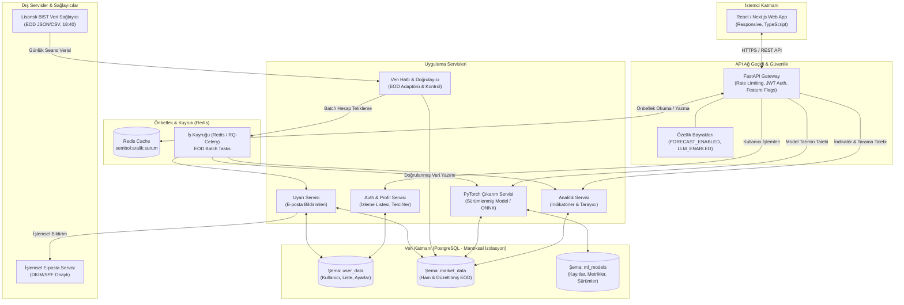
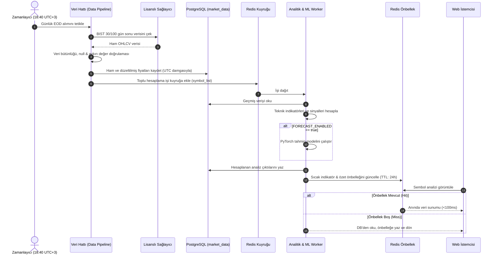

# Mimari Taslak

Bu belge, Borsa Analiz Sistemi'nin katmanlı mimarisini, veri akışını, bileşenler arası sınırları ve önbellek/toplu iş stratejilerini tanımlar. Uç nokta ve API sözleşme ayrıntıları için: [API_DRAFT.md](file:///c:/Users/msi/OneDrive/Desktop/BorA%C4%B1/BoraI/borsa_analiz_yol_haritasi_v2/docs/API_DRAFT.md).

---

## 1. Sistem Mimari Diyagramı

---

## 2. Uçtan Uca Veri Akışı (EOD Seans Sonu)

---

## 3. Servis Sorumlulukları ve İzolasyon Sınırları

- **`market_data`**: Sağlayıcı adaptörleri, şema doğrulama, aykırı değer filtreleme, normalizasyon (ham vs düzeltilmiş fiyat). Kullanıcı kimlik verilerine erişemez.
- **`analytics`**: Saf matematiksel ve finansal formüllerle teknik göstergeler üretir; deterministiktir.
- **`inference`**: Yalnızca sürüm onayı almış ve test edilmiş PyTorch modellerini barındırır. `FORECAST_ENABLED=false` iken arayüze devre dışı bilgisi iletir.
- **`alerts`**: EOD seans sonu tetiklenen kuralları işler, mükerrer bildirim engellemesi (rate limit) uygular.
- **`api` (FastAPI)**: JWT doğrulama, oran sınırlama (rate limit), önbellek koordinasyonu ve OpenAPI sözleşmelerini yönetir. Sağlayıcı API anahtarları asla istemciye sızdırılmaz.
- **`web`**: Erişilebilir, salt-okunur ve bilgilendirme odaklı arayüz.

---

## 4. Önbellek ve Toplu Hesap Stratejisi (v2)

- **Toplu (Batch) Üretim:** Kullanıcı istek anında ağır indikatör veya ML hesaplaması yapılmaz. Tüm hesaplamalar seans kapanışını (18:40) takiben worker'lar tarafından topluca yapılır.
- **Önbellek Anahtar Formatı:** `sembol:aralik:veri_surumu` (Örn: `THYAO:1D:20261018`).
- **Önbellek Yaşam Döngüsü (TTL):** EOD verisi için 24 saat veya yeni EOD paketi yüklenene kadar.
- **Özellik Bayrakları (Feature Flags):**
  - `FORECAST_ENABLED`: Model tahminlerini açar/kapatır. Kapalıyken UI "Tahmin modeli bakımda" uyarısı verir.
  - `LLM_ENABLED`: İsteğe bağlı metin özetini açar/kapatır.

---

## 5. Zaman ve Para Birimi Standartları

- **Zaman Saklama:** Veritabanındaki tüm zaman damgaları istisnasız `UTC (ISO 8601)` olarak saklanır.
- **Zaman Gösterimi:** Arayüzde `Europe/Istanbul (UTC+3)` yerel saat dilimine dönüştürülerek gösterilir.
- **Para Birimi:** BIST için `TRY` olarak saklanır ve formatlanır.
