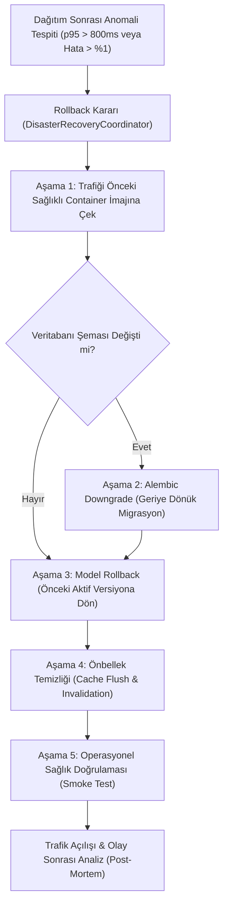

# Felaket Kurtarma, RPO/RTO Hedefleri ve Geri Dönüş (Rollback) Planı

Bu belge, **Borsa Analiz Sistemi** için tüm kritik alt sistemlerin (İlişkisel Veritabanı, Ham Piyasa Verisi, Model Paketleri ve Önbellek) felaket senaryoları karşısındaki iş sürekliliğini, kabul edilebilir azami veri kaybı (RPO) ve kurtarma süresi (RTO) hedeflerini, geri dönüş (rollback) akışlarını ve tatbikat protokollerini belirler.

---

## 1. Alt Sistemler ve RPO / RTO Hedefleri

| Alt Sistem | Veri Türü / Kapsam | RPO (Kurtarma Noktası Hedefi) | RTO (Kurtarma Süresi Hedefi) | Yedekleme Yöntemi ve Sıklığı |
|---|---|---|---|---|
| **İlişkisel Veritabanı (`DATABASE`)** | Kullanıcılar, oturumlar, izleme listeleri, alarm kuralları, model metadata, denetim kayıtları | **<= 1 Saat** (3600 sn) | **<= 30 Dakika** (1800 sn) | Saatlik WAL/PITR + Günlük kriptografik tam anlık görüntü (AES-256-GCM / PBKDF2) |
| **Ham Piyasa Verisi (`MARKET_DATA`)** | BIST EOD ham barları, kurumsal işlemler, sağlayıcı ham yanıtları | **<= 24 Saat** (86400 sn) | **<= 60 Dakika** (3600 sn) | Günlük artımlı (18:15 TSI) + Haftalık tam snapshot; WORM/değişmez depolama |
| **Model Kayıt Defteri (`MODEL_REGISTRY`)** | Eğitilmiş PyTorch modelleri, ağırlıklar (safetensors), ön işleyiciler, sürüm sözleşmeleri | **0 Saniye** (Değişmez/Immutable) | **<= 15 Dakika** (900 sn) | SHA-256 sağlama toplamlı versiyonlu paketler, çift bölge nesne depolama (Object Storage) |
| **Önbellek Katmanı (`CACHE`)** | Redis/In-memory HTTP yanıtları, kota sayaçları, geçici token'lar | **Kritik Değil** (Geçici veri) | **<= 5 Dakika** (300 sn) | Ephemeral bellek; yeniden başlatmada veritabanından / sağlayıcıdan otomatik soğuk başlatma (warm-up) |

---

## 2. Felaket Senaryoları ve Eylem Matrisi

### 2.1. Senaryo A: Donanım / Birincil Altyapı Çökmesi (Infrastructure Outage)
- **Tetikleyici:** Birincil sunucu / bulut bölgesi erişilemez hale geldiğinde.
- **Eylem:**
  1. Yük dengeleyicide (Load Balancer) DNS veya Anycast IP ikincil yedek bölgeye (Failover Region) yönlendirilir.
  2. İkincil bölgede en son doğrulanmış veritabanı anlık görüntüsü ayağa kaldırılır ve WAL günlükleri uygulanır.
  3. `OperationalMonitor` ve `DisasterRecoveryCoordinator` üzerinden hazırbulunuşluk doğrulanır.

### 2.2. Senaryo B: Veri Bozulması veya Hatalı Toplu İşlem (Data Corruption)
- **Tetikleyici:** Hatalı bir migrasyon, şema bozulması veya sağlayıcıdan gelen kirli verinin türetilmiş katmana kontrolsüz yayılması.
- **Eylem:**
  1. Hata tespiti anında API yazma işlemleri geçici olarak `READ_ONLY` moduna alınır.
  2. Veritabanı son bilinen sağlıklı zamana (Point-in-Time Recovery - PITR) geri döndürülür.
  3. Ham piyasa verisi değişmez (WORM) olduğundan bozulmaz; `MarketDataPipelineService` ile türetilmiş barlar temizlenip baştan hesaplanır.
  4. KVKK gereği geri yükleme sonrasında `PostRestoreSanitizer` çalıştırılarak silinmiş kullanıcı mezar taşları (`TombstoneRegistry`) temizlenir.

### 2.3. Senaryo C: Güvenlik İhlali / Fidye Yazılımı (Ransomware / Malicious Event)
- **Tetikleyici:** Yetkisiz erişim, veri şifreleme girişimi veya bütünlük ihlali.
- **Eylem:**
  1. Ağ bağlantıları derhal izole edilir (`IncidentResponseCoordinator` PICERL protokolü).
  2. Çevrimdışı (air-gapped / WORM mühürlü) kriptografik yedeklerden temiz bir ortama geri yükleme yapılır.
  3. Tüm aktif oturum belirteçleri ve API anahtarları `SecretManager` üzerinden geçersiz kılınır.

---

## 3. Geri Dönüş (Rollback) Planı

Yeni bir sürüm dağıtımında gerileme (regression), yüksek 5xx hata oranı veya p95 yanıt süresi ihlali durumunda aşağıdaki aşamalı geri dönüş süreci uygulanır:

### 3.1. Geri Dönüş Aşamaları Detayı
1. **Uygulama Rollback (Container/App):** Dağıtılan yeni konteyner imajı derhal önceki kararlı SHA etiketine geri çekilir.
2. **Şema Rollback (Alembic Migration):** Eğer dağıtımda şema değişikliği uygulandıysa, `alembic downgrade -1` ile geriye dönük güvenli revizyona dönülür.
3. **Model Rollback:** Yeni model canlıya alınmışsa `ModelGovernanceRegistry` üzerinden anında önceki aktif model `ModelLifecycleStage.ACTIVE` durumuna getirilir, yeni model `ARCHIVED` veya `SHADOW` statüsüne çekilir.
4. **Önbellek İptali:** Eski şema veya yeni modele ait anahtarlar Redis/In-memory önbellekten temizlenir.
5. **Sağlık Doğrulaması:** `/health` ve `/api/v1/operational-health` uç noktalarının yeşile döndüğü doğrulanır.

---

## 4. Tatbikat (Recovery Drill) Protokolü ve Doğrulama

Sistemin RPO ve RTO hedeflerine uyumu yalnızca kağıt üzerinde bırakılamaz; düzenli tatbikatlarla ölçülür:

1. **Tatbikat Sıklığı:** En geç 90 günde bir (çeyreklik) izole sandbox ortamında otomatik veya yarı-otomatik tatbikat icra edilir.
2. **Kriptografik Bütünlük:** Her yedek dosyasının SHA-256 sağlama toplamı manifest ile karşılaştırılır (`verify_checksum`).
3. **Süre Ölçümü:** Tatbikat başlangıcından veritabanının sorgulanabilir hale geldiği ana kadar geçen süre ölçülür (`drill_duration_seconds`).
4. **RTO Değerlendirmesi:** Eğer `drill_duration_seconds > rto_target_seconds` ise tatbikat **BAŞARISIZ (RTO BREACH)** kabul edilir ve alarm üretilir.
5. **KVKK Mezar Taşı Temizliği Testi:** Tatbikat sırasında silinmiş sahte bir hesabın mezar taşı taranır ve `PostRestoreSanitizer`'ın silme işlemini icra ettiği test edilir.

---

## 5. Metrikler ve Alarmlar

`DisasterRecoveryCoordinator` aşağıdaki operasyonel metrikleri sağlar:
- `dr_backup_age_seconds{subsystem}`: En son alınan yedeğin saniye cinsinden yaşı.
- `dr_rpo_target_seconds{subsystem}`: Tanımlı RPO hedef süresi.
- `dr_rto_target_seconds{subsystem}`: Tanımlı RTO hedef süresi.
- `dr_last_drill_duration_seconds{subsystem}`: Son tatbikatın tamamlanma süresi.
- `dr_rpo_breach_total{subsystem}`: RPO hedefinin aşıldığı durum sayacı.
- `dr_readiness_score`: 0.0 - 1.0 arası genel felaket kurtarma hazırbulunuşluk skoru.
