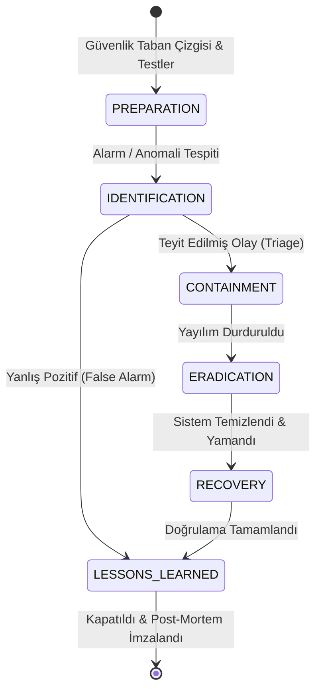

# Güvenlik Olayı Müdahale Planı ve İletişim Rehberi

Bu belge; Borsa Analiz Sistemi altyapısında meydana gelebilecek siber güvenlik olaylarına hızlı, disiplinli, yasalara tam uyumlu ve organize bir şekilde müdahale edilmesini sağlamak amacıyla hazırlanmıştır. 

Plan; **NIST SP 800-61 Rev. 2** (Computer Security Incident Handling Guide), **ISO/IEC 27035** standartları, **6698 Sayılı Kişisel Verilerin Korunması Kanunu (KVKK)** m. 12 düzenlemeleri ve **Sermaye Piyasası Kurulu (SPK)** Bilgi Sistemleri Yönetimi Tebliği (VII-128.9) esaslarına tam uyumludur.

---

## 1. Olay Şiddet Seviyeleri ve Müdahale SLA'leri

Olaylar etki alanı, veri gizliliği ve hizmet sürekliliğine göre 4 seviyede derecelendirilir:

| Şiddet Kodu | Seviye | Tanım & Kapsam Örnekleri | İlk Müdahale SLA | Güncelleme Sıklığı |
|---|---|---|---|---|
| **SEV-1** | **CRITICAL** | • Doğrulanmış kişisel veri (KVKK) veya finansal veri sızıntısı<br>• Aktif fidye yazılımı (ransomware) veya veri silme girişimi<br>• Sistem genelinde tam kesinti / veri manipülasyonu<br>• Süper yönetici (admin) kimlik bilgilerinin ele geçirilmesi | **< 15 dakika** | **Her 30 dakikada bir** |
| **SEV-2** | **HIGH** | • Kritik mikroservis kesintisi veya yetki yükseltme (IDOR/BOLA)<br>• Şüpheli API brute-force ve credential stuffing dalgası<br>• Model tahminlerine veya piyasa verilerine yetkisiz müdahale şüphesi<br>• Sır anahtarlarının (secret key) sızma ihtimali | **< 30 dakika** | **Her 60 dakikada bir** |
| **SEV-3** | **MEDIUM** | • Tekil kullanıcı anomalileri veya izole hesap kilitlemeleri<br>• Dağıtılmış zafiyet tarama trafiği ve anormal bot davranışı<br>• Kota veya rate-limit eşiklerinin yoğun aşılması | **< 2 saat** | **Her 4 saatte bir** |
| **SEV-4** | **LOW** | • Yanlış pozitif (false-positive) güvenlik alarmları<br>• Düşük riskli tarayıcı CSP raporları veya önemsiz log uyarıları<br>• Servis etkisi olmayan yetkisiz erişim denemeleri | **< 24 saat** | **Günlük bülten** |

---

## 2. Siber Olay Müdahale Ekibi (SIRT) ve İletişim Sorumluları

Güvenlik olaylarında rol karmaşasını önlemek adına kanonik RACI matrisi uygulanır:

```
R: Sorumlu (Responsible) — İşi fiilen yapan
A: Hesap Veren (Accountable) — Nihai karar ve onay mercii
C: Danışılan (Consulted) — Uzmanlık görüşü alınan
I: Bilgilendirilen (Informed) — Gelişmelerden haberdar edilen
```

### RACI Matrisi

| SIRT Rolü | Görev Unvanı | SEV-1 | SEV-2 | İletişim E-posta | Nöbetçi Telefonu | Yedek Sorumlu |
|---|---|:---:|:---:|---|---|---|
| **Olay Yöneticisi (Incident Commander)** | CISO / Güvenlik Direktörü | **A** | **A** | `ciso@bora-analiz.local` | `+90-212-555-0101` | CTO |
| **Teknik & Güvenlik Lideri** | Kıdemli SecOps Mühendisi | **R** | **R** | `secops@bora-analiz.local` | `+90-212-555-0102` | Güvenlik Analisti |
| **Hukuk ve Uyum Lideri** | Hukuk & KVKK Müşaviri | **C** | **C** | `compliance@bora-analiz.local` | `+90-212-555-0103` | Dış Hukuk Danışmanı |
| **Kurumsal İletişim Lideri** | Basın & Destek Sözcüsü | **R** | **I** | `comms@bora-analiz.local` | `+90-212-555-0104` | Operasyon Lideri |
| **Altyapı ve SRE Lideri** | DevOps / SRE Lideri | **R** | **R** | `sre-lead@bora-analiz.local` | `+90-212-555-0105` | DBA / SysAdmin |

### Dış Kurum ve Yasal Bildirim Kanalları

| Kurum / Otorite | Mevzuat Dayanağı | Zorunlu Bildirim Süresi | Bildirim Kanalı & Portal |
|---|---|---|---|
| **Kişisel Verileri Koruma Kurumu (KVKK)** | 6698 Sayılı Kanun m. 12/5 | **En geç 72 saat içinde** | `https://ihlal.kvkk.gov.tr` (Online Bildirim Modülü) |
| **Sermaye Piyasası Kurulu (SPK)** | VII-128.9 Tebliği m. 24 | **24 saat içinde (İvedilikle)** | `bilgisistemleri@spk.gov.tr` |
| **Ulusal Siber Olaylara Müdahale (USOM)** | Siber Güvenlik Mevzuatı | **24 saat içinde** | `ihbar@usom.gov.tr` / `https://www.usom.gov.tr/bildir` |

---

## 3. Altı Aşamalı Müdahale Döngüsü (PICERL Metodolojisi)

Sistem `src/stock_analysis/security/incident_response.py` modülü üzerinden PICERL durum makinesi kurallarıyla yönetilir:



1. **Hazırlık (Preparation):**
   - CI/CD güvenlik taramaları (`SecurityScannerSuite`), log maskeleme, şifreli yedekler ve hazır olay oyun kitapları.
2. **Tespit ve Teşhis (Identification):**
   - Alarm ve denetim loglarının (`AuditEvent`, `LogRecord`) analizi, saldırgan IP ve etkilenen varlıkların tespiti.
   - Olay şiddet derecesinin belirlenmesi (`declare_incident`).
3. **Sınırlama (Containment):**
   - **Kısa Vadeli:** İhlal edilen token/oturumların sonlandırılması (`revoke_all_sessions`), saldırgan IP'lerin engellenmesi (`quarantine_ip`), acil durum durdurma anahtarı (`activate_kill_switch`).
   - **Uzun Vadeli:** Şüpheli servislerin izole edilmesi, veritabanının salt-okunur moda alınması.
4. **Yok Etme (Eradication):**
   - Zararlı oturum, backdoor veya sızdırılmış anahtarların revoke edilmesi (`revoke_secrets`).
   - Güvenlik açığının kod seviyesinde kapatılması (hotfix) ve CI/CD hattından geçirilmesi.
5. **Kurtarma (Recovery):**
   - Temiz, şifreli ve bütünlüğü doğrulanmış yedekten geri yükleme (`DatabaseBackupEngine`).
   - Geri yüklenen veritabanında silinmiş kullanıcı haklarının canlanmasını önlemek için anında `PostRestoreSanitizer` çalıştırılması.
   - `PRAGMA integrity_check` ve servis canlılık (healthcheck) doğrulaması.
6. **Çıkarılan Dersler ve Kapanış (Lessons Learned):**
   - Olaydan sonraki 5 iş günü içinde Olay Komutanı liderliğinde post-mortem toplantısı düzenlenmesi.
   - 5-Why kök neden analizi ve takip edilecek aksiyon listesinin (Action Items) hazırlanıp imzalanması.

---

## 4. Senaryo Bazlı Müdahale Oyun Kitapları (Playbooks)

### PB-01: Veri Sızıntısı ve Veritabanı İhlali (Data Breach)
1. **Adım 1 (Tecrit):** Veritabanı hemen salt-okunur moda alınır; tüm aktif kullanıcı oturumları feshedilir (`REVOKE_ALL_SESSIONS`).
2. **Adım 2 (Adli Bilişim):** DB audit logları (`AuditEvent`), bağlantı kayıtları ve yavaş sorgu logları dondurularak SHA-256 özetiyle adli kopyası alınır.
3. **Adım 3 (Yasal Süreç Başlatma):** KVKK 72 saatlik geri sayım sayacı başlatılır (`LegalComplianceDeadline`). Hukuk Lideri ve CISO acil toplanır.
4. **Adım 4 (Temizleme):** Sızan anahtarlar döndürülür (`SecretManager.rotate_secret`). Açığa neden olan API ucu veya ORM filtresi kapatılır.
5. **Adım 5 (Bildirim):** `generate_kvkk_breach_report()` çıktısı ile Kuruma resmi bildirim yapılır; kullanıcılara `generate_user_advisory_notice()` duyurulur.

### PB-02: Brute-Force & Hesap Ele Geçirme (Account Takeover - ATO)
1. **Adım 1 (Engelleme):** Saldırgan IP havuzu `QUARANTINE_IP` ile güvenlik duvarında ve oran sınırlayıcıda karantinaya alınır.
2. **Adım 2 (Oturum İptali):** Etkilenen kullanıcı hesaplarının tüm açık oturumları kapatılır ve hesap durumları `LOCKED` konumuna alınır.
3. **Adım 3 (Parola Sıfırlama):** Kullanıcılara tek kullanımlık süreli güvenli sıfırlama bağlantısı gönderilir; zorunlu parola yenileme talep edilir.
4. **Adım 4 (MFA Doğrulama):** Kullanıcıya TOTP/MFA kurulumu yaptırılır.

### PB-03: Yönetici Yetki Aşımı ve Yetkisiz İdari İşlem (Privilege Escalation)
1. **Adım 1 (Durdurma):** Şüpheli idari kullanıcının tüm rolleri `revoke_role` ile sıfırlanır; `kill-switch` devreye alınır.
2. **Adım 2 (Denetim İncelemesi):** `src/stock_analysis/security/audit.py` üzerinden idari işlem kütükleri taranarak değiştirilen kullanıcı, model veya veritabanı kayıtları incelenir.
3. **Adım 3 (Geri Alma):** Yetkisiz işlem öncesindeki doğrulanmış duruma geri dönülür (rollback).
4. **Adım 4 (SPK İhbarı):** Yetkisiz işlem piyasa verisi veya model tahminini etkilediyse SPK Bilgi Sistemleri birimine ivedilikle bilgi verilir.

### PB-04: Tedarik Zinciri ve Model Zehirlenmesi (Supply Chain / Model Poisoning)
1. **Adım 1 (Model Karantinası):** `ModelGovernanceRegistry` üzerinden aktif model `ARCHIVED` statüsüne çekilir ve `FORECAST_ENABLED=False` yapılır.
2. **Adım 2 (Yedek Bağımlılık Taraması):** `PackageDependencyAuditor` ve `ContainerSecurityScanner` çalıştırılarak pyproject.toml ve Dockerfile katmanları taranır.
3. **Adım 3 (Doğrulama):** Safetensors ve SHA-256 model mühürleri kontrol edilir; bozulmuş ağırlıklar temiz yedekten yeniden yüklenir.
4. **Adım 4 (CI/CD Sertleştirme):** Kilit dosyasındaki (`uv.lock`) sağlama toplamları yenilenir.

### PB-05: DDoS ve Dağıtık Servis Dışı Bırakma (DoS)
1. **Adım 1 (Hız Kısıtlaması):** Anonim ve genel uçlarda kayan pencere oran sınırlaması en katı seviyeye (`TieredRateLimiter.STRICT`) çekilir.
2. **Adım 2 (Statik Önbellek Kalkanı):** Redis ve HTTP `ETag` katmanları devreye alınarak veritabanı sorguları bypass edilir.
3. **Adım 3 (CDN / WAF Koruması):** Ters vekil (Reverse Proxy) seviyesinde DDoS filtreleme ve CAPTCHA kalkanı devreye sokulur.

---

## 5. Dış İletişim, Kullanıcı Duyurusu ve SPK İlkeleri

Güvenlik olayları sırasında yapılacak açıklamalar şu ilkelere bağlı kalmak zorundadır:

1. **Spekülasyon Yasağı:** Doğrulanmamış hiçbir bilgi, şüphe veya varsayım kamuoyuyla paylaşılmaz.
2. **Piyasa Manipülasyonundan Kaçınma:** Açıklamalarda hisse senetleri, piyasa hareketleri veya model tahminlerine dair fiyat yönlendirmesi yapılamaz.
3. **Sır İfşasının Engellenmesi:** Güvenlik açığının teknik sömürü detayları (exploit adımları, açık kaynak kod parçaları) saldırganların faydalanmaması için kamuoyuna açıklanmaz.
4. **Kullanıcıya Şeffaf ve Eyleme Dönük Rehberlik:** Kullanıcı duyurusu doğrudan `generate_user_advisory_notice()` şablonuna dayanır ve kullanıcının atması gereken somut adımları (parola yenileme, MFA açma) net olarak bildirir.

---

## 6. Olay Sonrası İnceleme (Post-Mortem) Standardı

Her SEV-1 ve SEV-2 güvenlik vakasından sonra `generate_post_mortem_report()` fonksiyonu ile resmi bir rapor üretilir. Rapor asgari olarak şu bölümleri içerir:

1. **Olay Özeti ve SLA Başarısı:** Tespit zamanı, sınırlama süresi ve toplam kesinti/etki saati.
2. **5-Why Kök Neden Analizi:** Zafiyetin neden oluştuğu, sistem savunmasının neden ilk anda engellemediği derinlemesine irdelenir.
3. **Kronolojik İzleme:** Olay anından çözüme kadar her aşamanın adli zaman damgalı dökümü.
4. **Alınan Sınırlama ve Kurtarma Tedbirleri:** Yapılan müdahalelerin teknik dökümü.
5. **Geleceğe Dönük İyileştirme Aksiyonları (Action Items):** Sorumlu kişi ve tamamlanma tarihi atanmış mühendislik görevleri.
6. **Yönetici İmzaları:** Olay Komutanı ve Güvenlik Liderinin ortak onayı.
